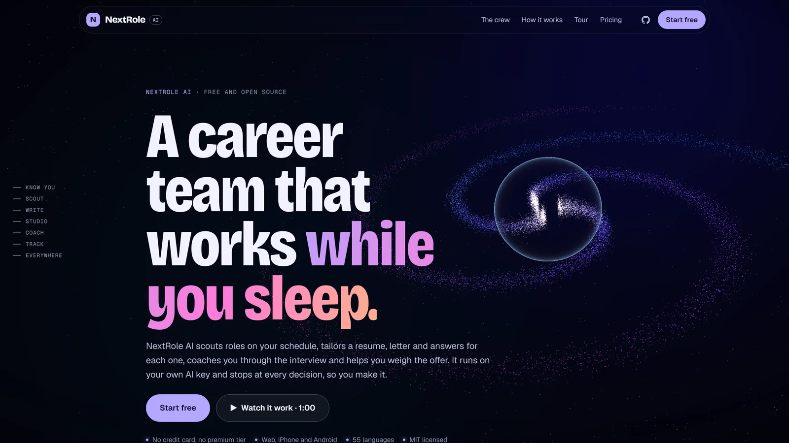
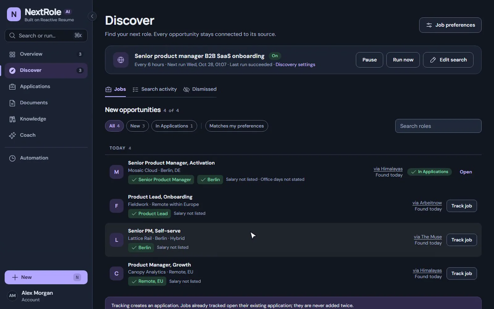
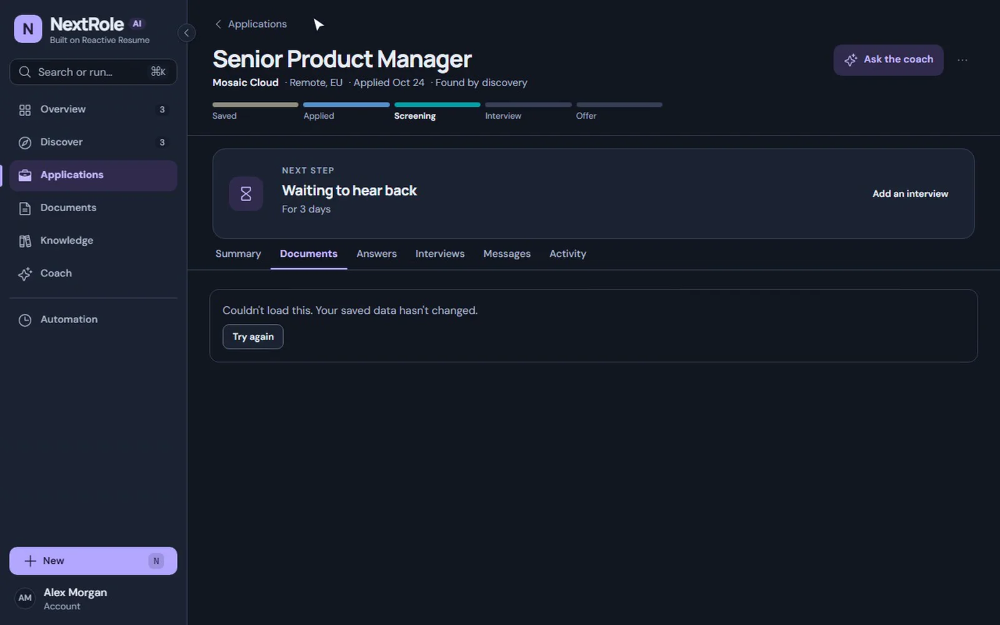
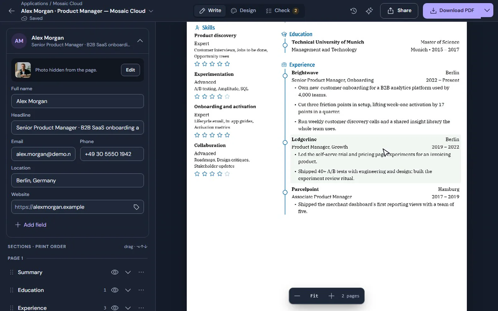
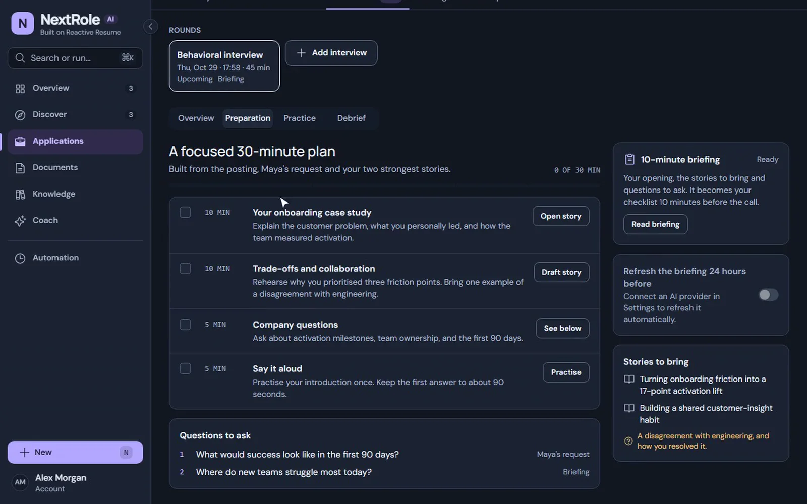
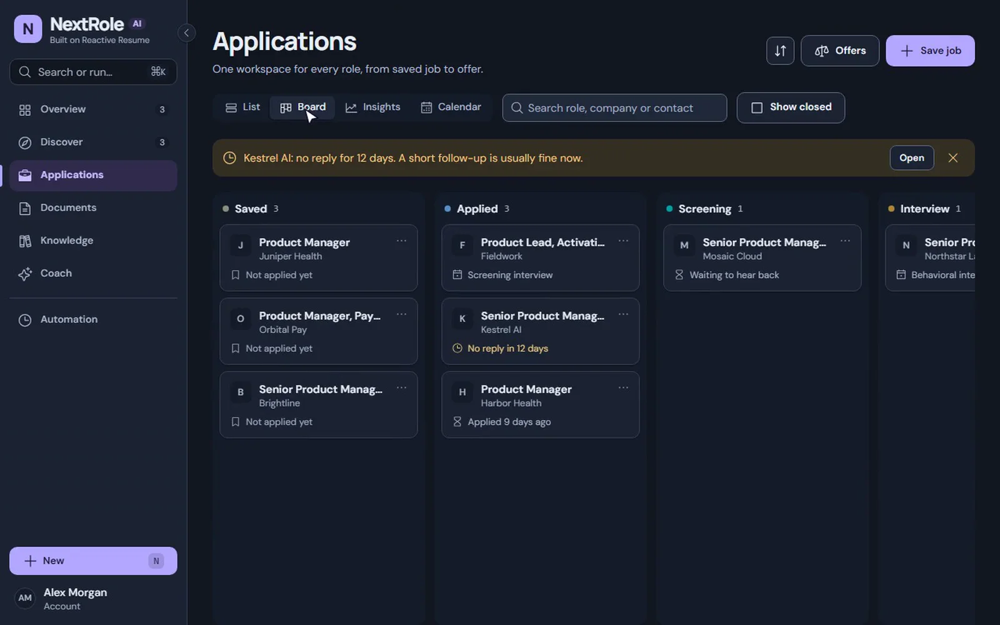
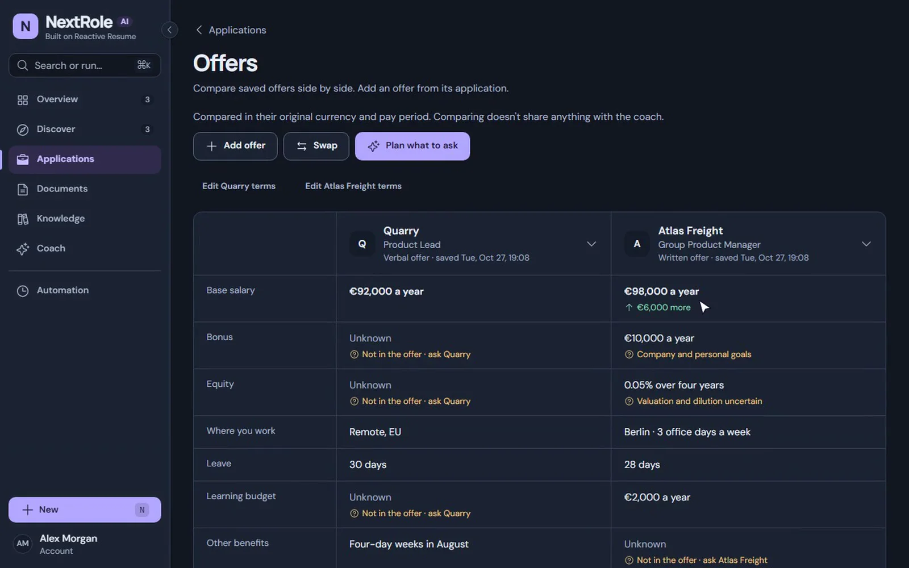

<div align="center">
  

  <h1>NextRole AI</h1>

  <p><strong>A career team that works while you sleep.</strong></p>

  <p>
    NextRole AI scouts roles on your schedule, tailors a resume, letter and answers for each one, coaches you through
    the interview and helps you weigh the offer. It runs on your own AI key and stops at every decision, so you make it.
  </p>

  <p>
    <a href="https://nextroleai.owaism.xyz"><strong>Try the live app</strong></a>
    ·
    <a href="#quick-start"><strong>Self-host it</strong></a>
    ·
    <a href="docs/getting-started.mdx"><strong>Read the docs</strong></a>
    ·
    <a href="apps/web/public/landing/tour.mp4"><strong>Watch the 60-second tour</strong></a>
  </p>

  <p>
    
    
    
  </p>
</div>

---

Try the live app at **[nextroleai.owaism.xyz](https://nextroleai.owaism.xyz)**, or self-host it with Docker.

NextRole AI is a free, open-source job search app. It finds roles, drafts the documents and prepares you for each
step, then hands everything back to you. **Nothing is submitted or sent in your name.** AI features use a provider you
connect, so you choose the model and pay only for what you use.

It is built on [Reactive Resume](https://github.com/reactive-resume/reactive-resume), the open-source resume builder by
Amruth Pillai and its contributors, so the full resume editor, templates and exports come with it.

## Meet the crew

Six specialists, one boss: you.

| Specialist      | What it does                                                                                                                     | What it hands you                           |
| --------------- | -------------------------------------------------------------------------------------------------------------------------------- | ------------------------------------------- |
| **The Scout**   | Searches 11 job boards, the companies you follow and the open web on your schedule, and says why it passed on the rest.          | A shortlist, with a fit check for each role |
| **The Writer**  | Tailors your resume, cover letter and form answers to each posting, using only experience you've confirmed.                      | Drafts ready to review, never sent          |
| **The Editor**  | 18 templates, about 500 fonts and an ATS check that points to the exact line. Its suggestions wait for your yes.                 | A resume both software and people can read  |
| **The Coach**   | Briefs you before each interview, listens while you practise out loud, and turns every debrief into material for the next round. | A 30-minute plan for every interview        |
| **The Tracker** | One board for every application, with interviews on your calendar, follow-up reminders and replies drafted for recruiters.       | Your next step on every application         |
| **The Advisor** | Lines offers up against what you said matters, and keeps the unknown terms in plain sight.                                       | The questions to ask before you sign        |

## See it work

<table>
  <tr>
    <td width="50%"><br /><sub><b>Discover.</b> A scheduled search across job boards and the web, with every run's results and reasons.</sub></td>
    <td width="50%"><br /><sub><b>Fit.</b> Which requirements your evidence supports, and which have no evidence yet.</sub></td>
  </tr>
  <tr>
    <td><br /><sub><b>Studio.</b> The tailored resume in the Reactive Resume editor, with Write, Design and Check modes.</sub></td>
    <td><br /><sub><b>Coach.</b> A focused 30-minute plan and a briefing before the interview.</sub></td>
  </tr>
  <tr>
    <td><br /><sub><b>Tracker.</b> Every application on one board, from saved to offer.</sub></td>
    <td><br /><sub><b>Advisor.</b> Offers compared against your preferences, unknowns kept visible.</sub></td>
  </tr>
</table>

<sub>Screens from the tour, filmed on a fictional account.</sub>

## Features

**Find and prepare**

- Scheduled discovery every 1, 3 or 6 hours or daily, across Himalayas, Remote OK, The Muse, Arbeitnow, Jobicy, We Work
  Remotely, Bundesagentur, Adzuna, Reed, Jooble, USAJOBS, followed company boards (Greenhouse, Lever, Ashby and more)
  and web search. Every run shows what it found, skipped and rejected, and why.
- Knowledge: facts and five-part stories (situation, task, action, result, reflection) you confirm once and reuse.
- Fit checks that show the evidence behind each requirement.
- Automatic tailored resumes and cover letters per role, within a daily limit, with accuracy guards: dates, employers
  and titles never change, and invented figures are discarded.
- Application answers drafted within word counts, regenerate with a focus, and version history with compare and restore.

**Interview and decide**

- Briefings before each interview, timed preparation plans, practice out loud with transcription and feedback, a coach
  conversation, and debriefs that feed your Knowledge.
- Applications as a list, board, calendar and insights (reply rate, time to first reply, tailored vs base resume).
- Drafted recruiter replies, follow-up reminders, `.ics` calendar files, CSV import and export.
- Offer comparison against your preferences.

**The resume builder** (from Reactive Resume)

- 18 templates, about 500 fonts, layout and page controls, and fit to one page in a click.
- Check mode: ATS readability pinned to lines, job matching and wording review.
- An assistant that proposes edits you accept or reject one at a time.
- Import from PDF, Word, LinkedIn or JSON Resume; export to PDF, Word, OpenDocument, Markdown or JSON.
- Public links with optional passwords and view counts, cover letters, tags, trash and private notes.

**Everywhere, and yours**

- Native iPhone and Android apps (Expo) with the same features as the web, in 55 languages.
- MCP server, WebMCP, REST and JSON Patch APIs, and agent skills for Claude, Codex and Cursor.
- Bring your own AI: OpenAI, Anthropic, Google Gemini, DeepSeek, Mistral, Groq, xAI, OpenRouter, Ollama or any
  OpenAI-compatible endpoint.
- Passkeys, two-step sign-in, and an ATS checker that reads your PDF in your browser.
- Self-host with one Docker image and PostgreSQL. Export everything as JSON at any time.

## Quick start

Build and run this checkout with Docker and Docker Compose:

```bash
git clone https://github.com/owaismultani/nextrole-ai.git nextrole-ai
cd nextrole-ai

# Create your local configuration
cp .env.example .env
# Edit .env: set AUTH_SECRET and a separate ENCRYPTION_SECRET.
# Generate each secret with: openssl rand -hex 32

# Build the app and start PostgreSQL, Redis and SeaweedFS
docker compose up -d --build

# Open http://localhost:3000
```

Then connect an AI provider in **Settings → Integrations** if you want tailoring, coaching and the assistant, and open
**Discover** to set up your first search. Free job sources work without any keys.

To run a published image instead, pull `ghcr.io/owaismultani/nextrole-ai:latest` and follow the
[Docker guide](docs/self-hosting/docker.mdx). Kubernetes, Vercel, Cloudflare Workers and NAS guides are in
[`docs/self-hosting`](docs/self-hosting). Every server setting is listed in
[environment variables](docs/self-hosting/environment-variables.mdx).

## Develop

Requirements: Node.js 24, pnpm 12 and Docker.

```bash
pnpm install --frozen-lockfile
cp .env.example .env.local   # then point it at localhost; see the development guide
docker compose -f compose.dev.yml up -d postgres redis seaweedfs seaweedfs_create_bucket
pnpm dev                     # web on :3000, API on :3001
```

The [development guide](docs/contributing/development.mdx) covers the setup in full, and
[`AGENTS.md`](AGENTS.md) explains the repository's layout and conventions.

| Area    | Technology                                                                            |
| ------- | ------------------------------------------------------------------------------------- |
| Web     | React 19, TanStack Router and Query, Tailwind CSS, Vite, three.js on the landing page |
| Server  | Hono on Node.js 24 or Cloudflare Workers                                              |
| Mobile  | Expo / React Native with a native PDF renderer                                        |
| Data    | PostgreSQL with Drizzle ORM, Redis, S3-compatible storage                             |
| API     | oRPC, OpenAPI REST, MCP                                                               |
| Auth    | Better Auth with passkeys, 2FA, OAuth and SSO                                         |
| Tooling | TypeScript, pnpm and Turborepo, Vitest, Playwright, oxlint                            |

## Documentation

The [`docs`](docs) folder is a [Mintlify](https://mintlify.com) site. Preview it locally with the [Mintlify CLI](https://mintlify.com/docs/installation).

| Guide                                                                      | What it covers                                          |
| -------------------------------------------------------------------------- | ------------------------------------------------------- |
| [Introduction](docs/getting-started.mdx)                                   | What NextRole AI does and where to start                |
| [Automate your job search](docs/guides/automating-your-job-search.mdx)     | Discovery, tailored documents and the daily limit       |
| [Your career, in one place](docs/guides/career-overview.mdx)               | Overview, Discover, Knowledge, the coach and Automation |
| [Get ready for interview day](docs/guides/preparing-for-interview-day.mdx) | Briefings, practice and debriefs                        |
| [Tracking job applications](docs/guides/tracking-job-applications.mdx)     | Board, list, calendar and insights                      |
| [Resume editor](docs/guides/editor-overview.mdx)                           | Write, Design and Check                                 |
| [Self-hosting with Docker](docs/self-hosting/docker.mdx)                   | Deploying your own instance                             |
| [Using the MCP server](docs/guides/using-the-mcp-server.mdx)               | Connecting AI clients                                   |
| [Changelog](docs/changelog/index.mdx)                                      | What changed in NextRole AI                             |

## Contributing

Bug reports, translations and pull requests are welcome.

1. Fork the repository and create a branch (`git checkout -b feat/your-change`).
2. Commit with [Conventional Commits](https://www.conventionalcommits.org) (`feat: …`, `fix: …`).
3. Run `pnpm check` and the relevant tests.
4. Open a pull request.

To translate, see [contributing translations](docs/contributing/translations.mdx). To report a security issue, see
[`SECURITY.md`](SECURITY.md).

## Credits

NextRole AI is built on [Reactive Resume](https://github.com/reactive-resume/reactive-resume) by
[Amruth Pillai](https://github.com/AmruthPillai) and its community of contributors and translators. The resume editor,
templates, PDF renderer, importers, exports and most translations come from that project. If the resume builder helps
you, consider [supporting Reactive Resume](https://opencollective.com/reactive-resume).

## License

[MIT](LICENSE). Copyright © 2026 Amruth Pillai (Reactive Resume) and Owais Multani (NextRole AI).
